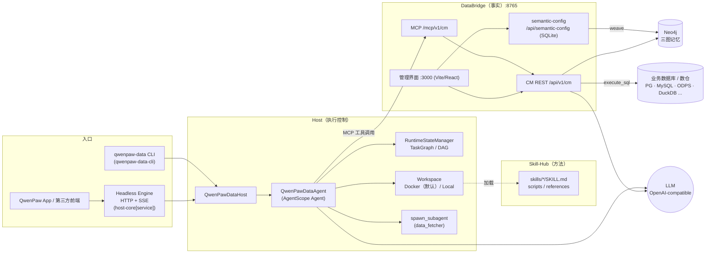
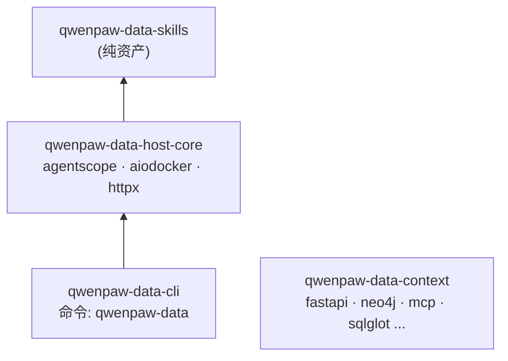
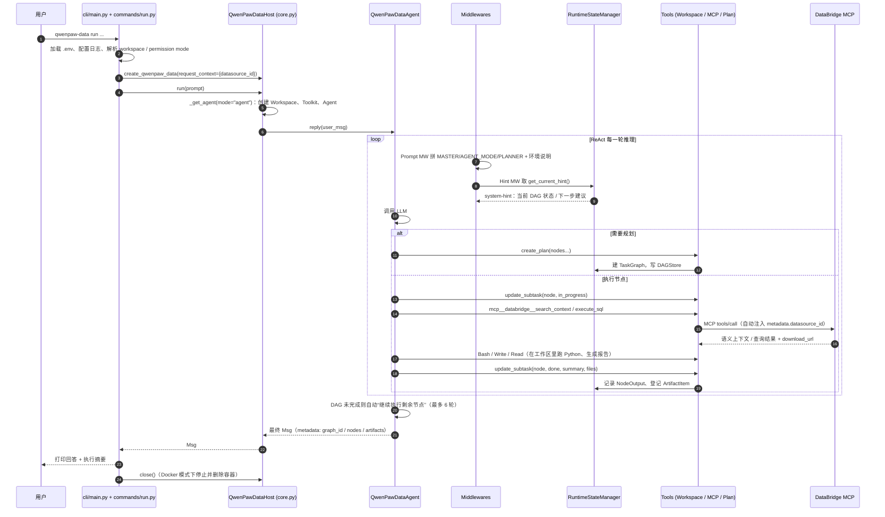
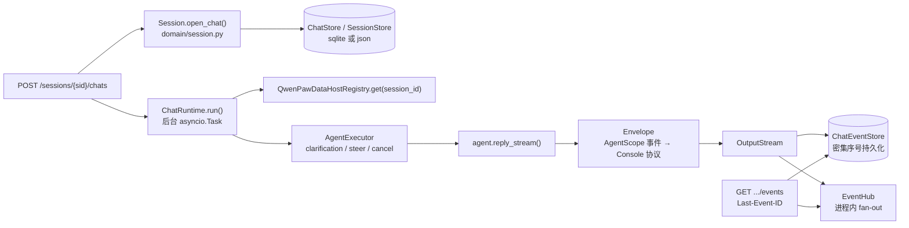
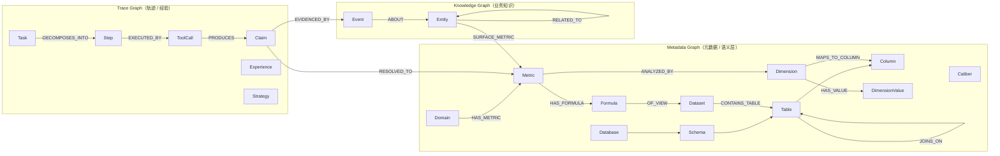
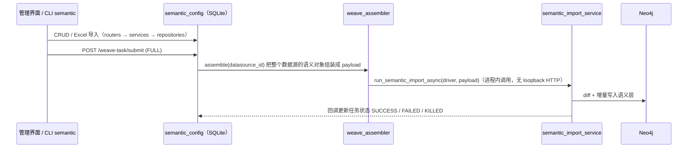

# QwenPaw-Data Architecture & Source Code Guide

> 面向想要**系统学习 QwenPaw-Data 架构与源码实现**的开发者。本文按“全局 → 子系统 → 关键链路 → 设计取舍”的顺序组织，
> 每一节都给出对应的源码入口，建议边读边打开代码对照。
>
> 适用版本：`0.3.x`（workspace 版本见根目录 `pyproject.toml`）。产品介绍与快速开始请先读 [README_ZH.md](../README_ZH.md)。

## Table of Contents

1. [How to Use This Guide](#1-how-to-use-this-guide)
2. [The Big Picture](#2-the-big-picture)
3. [Repository Map](#3-repository-map)
4. [End-to-End Flow: One `qwenpaw-data run`](#4-end-to-end-flow-one-qwenpaw-data-run)
5. [Host Core: The Execution Engine](#5-host-core-the-execution-engine)
6. [DataBridge: The Fact Layer](#6-databridge-the-fact-layer)
7. [Skill-Hub: The Method Layer](#7-skill-hub-the-method-layer)
8. [CLI Package](#8-cli-package)
9. [Cross-Cutting Concerns](#9-cross-cutting-concerns)
10. [Key Design Decisions](#10-key-design-decisions)
11. [Suggested Learning Path](#11-suggested-learning-path)
12. [Glossary](#12-glossary)

---

## 1. How to Use This Guide

推荐的三遍读法：

| 遍数 | 目标 | 读哪些章节 | 花费 |
| --- | --- | --- | --- |
| 第一遍 | 建立全局心智模型：有哪些包、谁调用谁 | §2、§3、§4 | ~1 小时 |
| 第二遍 | 吃透执行内核（Agent + DAG + 工具） | §5.1–§5.7，配合 §11 的练习 | 半天 |
| 第三遍 | 按兴趣深入：服务化/SSE、图谱检索、知识抽取、技能体系 | §5.8–§5.10、§6、§7 | 按需 |

阅读约定：

- 源码路径均相对仓库根目录；`host-core/...` 是 `packages/qwenpaw-data-host-core/src/qwenpaw_data/host/core/...` 的简写，
  `context/...` 是 `packages/qwenpaw-data-context/src/...` 的简写。
- 代码中大量使用中文注释与 docstring，模块开头的 docstring 通常就是该模块最好的“设计说明”，阅读时请优先看它。
- 项目建立在 [AgentScope 2.0](https://github.com/agentscope-ai/agentscope) 之上。`Agent`、`Toolkit`、`MiddlewareBase`、
  `Workspace`、`MCPClient`、`PermissionMode` 等概念来自 AgentScope，QwenPaw-Data 通过**子类化 + 中间件**扩展它们。
  不熟悉 AgentScope 的读者，建议先了解它的 ReAct 循环与事件流（`reply_stream` 产出的 `AgentEvent`）。

---

## 2. The Big Picture

### 2.1 Three Questions, Three Subsystems

QwenPaw-Data 把企业数据分析拆成智能体必须回答的三个问题，并分别交给三个子系统：

| 问题 | 子系统 | 对应包 | 一句话职责 |
| --- | --- | --- | --- |
| 应该用哪些**事实**？ | **DataBridge** | `qwenpaw-data-context` | 把元数据、业务知识、历史轨迹组织成可检索的图记忆，通过 REST / MCP 提供“语义上下文”和受控取数 |
| 应该**如何分析**？ | **Skill-Hub** | `qwenpaw-data-skills` | 纯资产包：路由/规划/工作流/原子分析技能（`SKILL.md` + 脚本 + 参考资料） |
| 应该**如何执行**？ | **Host** | `qwenpaw-data-host-core`（+ `qwenpaw-data-cli`） | AgentScope 智能体 + DAG 编排 + 工作区沙箱 + 产物登记 + 可选的 HTTP/SSE 服务 |

### 2.2 Runtime Topology



要点：

- **Host 与 DataBridge 是两个独立进程**，唯一的耦合点是 MCP（`http://127.0.0.1:8765/mcp/v1/cm`）以及少量 HTTP 发现接口。
  Host 对 DataBridge 没有 Python import 依赖（`qwenpaw-data-host-core` 的依赖列表里没有 `qwenpaw-data-context`）。
- **Skill-Hub 是静态资产**，Host 在构建工作区时把技能目录挂进去，由 AgentScope 的 skill 机制按需加载。
- **DataBridge 自身是一个单进程、单端口服务**，同时挂载 CM 语义 API、语义配置编辑层、图谱运维 API 和 MCP。

### 2.3 Package Dependency Graph



`qwenpaw-data-context` 是独立的一支：它既可以作为服务运行，也可以作为库使用（`pip install qwenpaw-data-context`），与 Host 之间只通过网络协议交互。
四个包由根目录 `pyproject.toml` 的 `[tool.uv.workspace]` 统一管理，版本号同步发布。

---

## 3. Repository Map

```text
QwenPaw-Data/
├── packages/
│   ├── qwenpaw-data-host-core/   # Host 执行内核（本文 §5）
│   ├── qwenpaw-data-cli/         # CLI 入口（§8）
│   ├── qwenpaw-data-context/     # DataBridge：后端 + 前端（§6）
│   │   ├── src/context_manager/  #   CM 核心：图构建、检索、API、MCP
│   │   ├── src/semantic_config/  #   语义配置编辑层（SQLite CRUD + Excel 导入 + weave）
│   │   ├── src/qwenpaw_data/context/  # 基础设施：路径、job store、资源预算、阻塞 IO 治理
│   │   ├── frontend/             #   管理界面（React 19 + Vite + antd + G6）
│   │   └── scripts/              #   serve.py、离线建图脚本
│   └── qwenpaw-data-skills/      # Skill-Hub 技能资产（§7）
├── skills/qwenpaw-data-cli/      # 给“外部自动化 agent”使用 CLI 的技能说明
├── scripts/                      # 本地初始化/启动/校验脚本（init_local、start_local、verify.sh ...）
├── examples/                     # 可复现 demo：GAAP 合成数据、语义配置工作簿、KG 文档、smoke test
├── tests/                        # 跨包测试（脚本、示例、开源卫生、SBOM ...）
└── docs/                         # 设计记录、发布、兼容性、资源治理等文档
```

规模感知（Python 代码行数，大致）：

| 区域 | LOC | 说明 |
| --- | --- | --- |
| `context_manager/` | ~59K | 其中 `api/` ~20K、`graph/` ~20K、`runtime/` ~6K、`knowledge/` ~5K |
| `host-core/` | ~27K | 其中 `algo/` 最大（BizTrace / FollowUp / Settlement） |
| `semantic_config/` | ~4K | 典型的 router → service → repository → model 分层 |
| `cli/` | ~2K | argparse 子命令 |

---

## 4. End-to-End Flow: One `qwenpaw-data run`

以 README 中的示例为线索：

```bash
qwenpaw-data run --no-stream --datasource-id postgresql-demo-gaap \
  "分析 2026 年 3 月 product X 有效用户的平均 GAAP 值……"
```



把这张图读懂，就掌握了 Host 的 80%。接下来逐层展开。

---

## 5. Host Core: The Execution Engine

### 5.1 `QwenPawDataHost` — the runtime handle

**源码**：`host-core/core.py`、`host-core/registry.py`、`host-core/__init__.py`

- `QwenPawDataHost` 是**一个 session 的运行句柄**，对外只暴露三个动作：
  - `plan(prompt)`：只规划，产出 `SOP`（放在 `msg.metadata["plan"]`）。
  - `execute(sop)`：加载一份 SOP（dict/YAML/对象）并驱动到完成。
  - `run(prompt)`：规划 + 执行一步到位。
- 构造时决定：`home`（本地状态根目录）、`model`（默认 `build_model_from_env()`）、`workspace_type`（`docker`/`local`）、
  `permission_mode`、`request_context`（如 `datasource_id`）、额外中间件等。
- `_get_agent()` 是**装配工厂**，第一次调用时按顺序完成：
  1. `_workspace()`：创建并 `initialize()` 工作区（Docker 容器或本地目录）。
  2. 创建 `RuntimeStateManager`（DAG 状态机），配置 artifact 路径上下文。
  3. `build_qwenpaw_data_toolkit(...)`：组装工具箱（§5.3）。
  4. `build_permission_context(...)`：生成权限上下文（§5.6）。
  5. 实例化 `QwenPawDataAgent`，挂上 `SqlArtifactMiddleware` 与外部传入的中间件。
  6. `rs.configure_dag_store(...)`：让 DAG 每次变化都持久化到 `sessions/dag/`。
- Agent **按 session 缓存**：同一个 Host 再次调用只切换 `mode` 与 `request_context`，从而在多轮对话中保留上下文与 DAG。
- `QwenPawDataHostRegistry` 是服务端用的“session_id → Host”缓存，服务模式下总是打开 `enable_clarification=True`
  （CLI 直接调用 `agent.reply()`，无法处理 `ask_user_question` 的挂起，因此 CLI 关闭该能力）。
- `__init__.py` 用模块级 `__getattr__` 做**惰性导入**：只用 `Paths` 的调用方不会被迫加载 AgentScope 全家桶。

### 5.2 `QwenPawDataAgent` — AgentScope agent with a DAG brain

**源码**：`host-core/agent/qwenpaw_data_agent.py`

它是 `agentscope.agent.Agent` 的子类，增加了以下关键行为：

| 能力 | 实现要点 |
| --- | --- |
| **双模式** | `set_mode("plan"|"agent")` 同时设置 `state.tool_context.activated_groups` 和 toolkit 的模式边界；Plan 模式下只能用规划类工具，且 MCP 的 `execute_sql` 被屏蔽 |
| **System prompt 全由中间件生成** | 构造时 `system_prompt=""`，由 `QwenPawDataPromptMiddleware` 每轮生成 |
| **自动续跑** | `reply_stream()` 结束后，如果在 agent 模式且当前图未完成，会以“继续执行剩余未完成的节点。”为输入再驱动，最多 `_MAX_DRIVE_ROUNDS = 6` 轮 |
| **权限确认闭环** | `_reply_with_confirmations()` 捕获 `RequireUserConfirmEvent`，交给 `confirmation_handler`；处理器缺失、抛错或 reply_id 不匹配时一律**拒绝**（fail-closed） |
| **CM 元数据注入** | `_execute_tool_call()` 在 AgentScope 校验工具入参之前，把 `request_context.datasource_id` 写进 CM MCP 调用的 `metadata` 参数 |
| **MCP 调用日志** | 对 `mcp__*` 工具记录 `MCP_TOOL_CALL_START/END` 及耗时，可与 DataBridge 侧日志按 run id 关联排障 |
| **执行元数据** | `set_execution_metadata()` 把 `graph_id`、`completed`、`nodes`、`artifacts` 写入最终 `Msg.metadata`，CLI 的执行摘要就来自这里 |
| **中断提示** | `handle_interrupt()` 返回当前 DAG 的 Markdown 进度，引导用户“继续”或修改 |

内置中间件栈（`_build_middlewares()`，追加在外部中间件之后）：

```text
QwenPawDataReplyMiddleware   ── on_reply：记录 trigger_msg_id；把前端对 DAG 的编辑以 [外部变更通知] 注入记忆
QwenPawDataTraceMiddleware   ── on_reply / on_reasoning / on_acting：把输入、推理块、工具调用与结果写入 session trace
QwenPawDataPromptMiddleware  ── on_system_prompt：MASTER.md + (PLAN_MODE.md | AGENT_MODE.md) + PLANNER.md + ANALYSIS_ENVIRONMENT.md
QwenPawDataHintMiddleware    ── on_system_prompt：追加 <system-hint>，即当前 DAG 的状态与“下一步该做什么”
```

> **学习提示**：这是一种“**用 prompt 状态机驱动 LLM**”的设计——DAG 状态保存在 Python 里，
> 每轮通过 hint 告诉模型“现在 ready 的节点是谁、只能同时做一个、做完要 `update_subtask`”，
> 模型的工具调用再反过来推进状态。读 `orchestration/hint.py` 的五种提示模板最能体会这一点。

### 5.3 Toolkit Assembly

**源码**：`host-core/agent/toolkit.py`、`host-core/mcp_cm.py`

`build_qwenpaw_data_toolkit()` 产出一个 `QwenPawDataToolkit`（`Toolkit` 子类），工具按 **ToolGroup** 分组：

| 组 | 工具 | 说明 |
| --- | --- | --- |
| basic（始终可用） | `create_plan`、`revise_current_plan`（即 `PLAN_MODE_TOOL_NAMES`）、`ask_user_question`（服务模式） + 除 `execute_sql` 之外的 MCP 工具 | Plan 与 Agent 模式都能用 |
| `plan` | — | 只用于约束说明 |
| `agent` | `update_subtask`、`finish_plan`、`spawn_subagent`、`cron_job`（服务模式）、工作区工具（`Bash/Read/Write/Edit/Glob/Grep`）、MCP 中的 `execute_sql`、Skills | 仅执行模式 |

MCP 相关的几个工程细节非常值得学习：

- **CM 识别是“特判”而非白名单**：`is_cm_mcp_config()` 只认 URL 中包含 `/mcp/v1/cm` 的 `http_mcp` 客户端。
  对它：把超时提高到 2400s（`QWENPAW_DATA_CM_MCP_TIMEOUT` 可调）、注入 `Authorization` 头、记录工具名前缀用于后续 metadata 注入。
  其它 MCP 走通用路径，因此用户可以在 `.mcp` 中自由挂载别的 MCP Server。
- **兜底超时**：AgentScope 默认 `execution_timeout=None`，服务端静默崩溃会让调用永远挂起；这里统一补上 120s 兜底
  （`QWENPAW_DATA_MCP_EXECUTION_TIMEOUT`）。
- **一次发现，多处复用**：`_MCPToolCatalog` 让每个 MCP 客户端的 `tools/list` 在进程内只请求一次（带 15s 超时），
  plan/agent 两个视图以及子智能体通过 `_FilteredMCPClient` 共享同一个目录、按谓词过滤。
- **关联 ID**：`_inject_run_header()` 给 HTTP MCP 加上 `x-qwenpaw-data-run` 头，使客户端 `mcp_client.log` 与 DataBridge 的访问日志可以 join。

### 5.4 Orchestration: TaskGraph / DAG

**源码**：`host-core/orchestration/`

```text
orchestration/
├── task_graph.py   # 数据模型：TaskNode、NodeOutput、FileRef、SOP、DAG patch；图算法：拓扑校验、就绪节点、下游重置、增删改
├── state.py        # RuntimeStateManager：持有 _nodes 与当前 graph，实现 4 个工具的业务逻辑、产物校验与登记、序列化
├── tools.py        # 把 RuntimeStateManager 的方法包装成 AgentScope ToolBase（CreatePlan / UpdateSubtask / ...）
├── hint.py         # DefaultGraphToHint：根据 DAG 状态生成 <system-hint>
├── middleware.py   # Prompt / Hint / Reply / Trace 中间件
├── dag_store.py    # DAGStore（JSON 快照落盘）+ DAGBroadcaster（进程内订阅）
├── events.py       # TaskEvent：object="task_status" 的 SSE 线协议
└── artifact.py     # ArtifactItem：session 级产物索引（append-only）
```

**核心数据模型**：

```python
class TaskNode(BaseModel):
    id: str; graph_id: str; name: str
    description: str; expected_outcome: str
    state: Literal["todo", "in_progress", "done", "failed", "abandoned"] = "todo"
    deps: list[str]                       # 上游节点 id
    output: NodeOutput | None             # reasoning / summary / files
```

- `SOP` 是**无运行态**的纯结构（name/description/expected_outcome/nodes），可以导出 YAML、人工编辑后再 `execute`——
  这就是 CLI `plan` → `execute` 两段式工作流的基础。`SOP.from_dict()` 严格校验：拒绝运行态字段、未知字段、未知依赖与环。
- **四个规划工具**（`state.py`）：
  - `create_plan`：生成新 graph_id，规范化依赖，归档旧图，写入 registry 并持久化。
  - `update_subtask`：状态迁移；`done` 必须带 `reasoning` 和 `summary`，`files` 会经过路径包含性校验、HTML 报告校验
    （禁止 ``）后登记为 `ArtifactItem`；同一时刻只允许一个 `in_progress` 节点（**串行执行**约束）。
  - `revise_current_plan`：批量 add/revise/delete，**原子**应用，修改某节点会把它及其下游重置为 `todo`。
  - `finish_plan`：给所有非终态节点打上 `done/abandoned` 并清空当前图。
- **持久化**：每次图变化调用 `_notify_graph_change()` → `DAGStore.write()`，前端可据此全量刷新 DAG 视图（零合并逻辑）。

`DefaultGraphToHint` 的分类逻辑（按优先级）：无图 → `no_graph`；存在 `in_progress` → `in_progress_hint`（中断恢复）；
全部终态 → `all_done`（总结并 `finish_plan`）；全部 todo → `at_beginning`；其它 → `ready_nodes_hint`。

### 5.5 Prompts

**源码**：`host-core/prompts/`（`MASTER.md`、`PLAN_MODE.md`、`AGENT_MODE.md`、`PLANNER.md`、`ANALYSIS_ENVIRONMENT.md`）

- Prompt 以 Markdown 文件形式随 wheel 发布（见 `pyproject.toml` 的 `artifacts`），便于审阅与迭代。
- `MASTER.md` 中用 `<!-- QWENPAW_DATA_SUBAGENT_BEGIN/END -->` 包裹子智能体说明，`QWENPAW_DATA_SPAWN_SUBAGENT_ENABLED` 关闭时会被剪掉，保证提示词与可用工具一致。
- 值得精读的规则：**多解先确认**、**SQL 单次最多 1000 行**、**`download_url` 才是完整结果入口**、
  **产物按 `artifacts/<session_id>/<graph_id>/<node_id>/` 落盘**、**最终报告必须是用 ECharts 内联数据的 HTML**。
  这些规则与代码中的校验（如 `update_subtask` 对 HTML 的检查）互相印证。

### 5.6 Workspace, Sandbox & Permissions

**源码**：`host-core/utils/workspace.py`、`host-core/tools/workspace.py`、`host-core/permission.py`、`host-core/paths.py`

| 后端 | 实现 | 隔离 | 默认权限模式 |
| --- | --- | --- | --- |
| `docker`（默认） | `_QwenPawDataDockerWorkspace`（继承 AgentScope `DockerWorkspace`） | 每会话一个容器，只挂载工作区目录 | `bypass`（容器即边界） |
| `local` | `QwenPawDataLocalWorkspace` + `Workspace*` 工具 | 文件工具限制在工作区内，**Shell 仍以宿主用户权限执行** | 交互式 `accept_edits`，非交互 `dont_ask` |

实现细节：

- Docker 镜像默认 `python:3.11-slim`，预装分析栈（pandas/numpy/matplotlib/openpyxl/tabulate），并**钉住与宿主相同版本**的 `agentscope`、`mcp`，避免容器内序列化不兼容。
- `.mcp` 中的 `127.0.0.1/localhost` 在容器初始化时被临时改写为 `host.docker.internal`（可配置），初始化后再恢复宿主文件，宿主侧工具不受影响。
- `ManagedDockerBash` / `WorkspaceBash` 把命令放在独立进程组中，超时或取消时先 `SIGTERM` 再 `SIGKILL` 整组回收；回收失败则直接关闭容器（fail-closed）。
- 权限策略 `auto` 的解析逻辑见 `cli/util.py::resolve_permission_mode` 与 `host-core/permission.py`；子智能体无法自行请求确认，需要确认的调用默认拒绝。

本地状态布局（`host-core/paths.py`，默认 `~/.qwenpaw-data/host/`）：

```text
host/
├── .secrets/
├── host.db                     # 服务模式 SQLite（WAL）
└── workspace/
    ├── .mcp                    # MCP 客户端配置（init_local 写入名为 databridge 的 CM 客户端）
    ├── skills/
    ├── sessions/{console,dag,<session_id>}/
    ├── data/
    └── artifacts/<session_id>/<graph_id>/<node_id>/
```

### 5.7 Sub-Agents

**源码**：`host-core/agent/spawn_subagent.py`

- `spawn_subagent(task, role)` 目前只支持 `role="data_fetcher"`：子智能体拿到 `Bash/Read/Write/Edit/Glob/Grep`、全部 MCP 工具以及
  `fetch-data` 技能，专注“把取数需求变成落盘 CSV”。
- 约束：最多并发 4、单次运行最多派生 20 个、每个最多 50 轮、超时 6000s。子智能体**不感知 DAG**，不会修改节点状态——
  这保证了 DAG 的唯一写者是主 agent。
- 子智能体的事件被转换为 `ToolChunk` 流式回传给父 agent（`_event_to_chunk`），因此在前端能看到“工具中的工具”。

### 5.8 Headless Service: Sessions, Chats & Replayable SSE

**源码**：`host-core/api/`、`host-core/runtime/`、`host-core/stream/`、`host-core/store/`、`host-core/domain/`

启动：`uvicorn --factory 'qwenpaw_data.host.core.api.app:create_app' --workers 1`（单进程，因为 EventHub 与运行时注册表都在内存中）。



关键设计：

- **领域对象与存储分离**：`domain/` 是纯 dataclass（`Session`、`Chat`、`Identity`、`Clarification`、`Steer`），
  `store/protocols.py` 定义仓储协议，`json_store.py` 与 `sql_store.py` 两套实现通过同一套一致性测试。
- **先持久化、再广播**：`OutputStream.append()` 先写 `ChatEventStore`（得到递增 `sequence_number`），再 `EventHub.publish()`。
- **可重放 SSE**（`api/routers/events.py`）：先 `hub.attach()` 订阅（避免回放期间丢事件），再从存储回放 `cursor` 之后的历史，
  然后转入实时流；按序号去重；遇到 `response` 终态（completed/failed/cancelled）关闭流；空闲时发送 `: keepalive` 注释。
  因此客户端断线重连、服务重启后都能续上。
- **`Envelope`**（`runtime/envelope.py`）是一个状态机，把 AgentScope 的细粒度事件（文本/推理/数据块的 start/delta/end、工具调用与结果、hint 块）
  翻译成 `response` / `message` / `content` / `task_status` 等对象。
- **`AgentExecutor`**（`runtime/executor.py`）驱动一轮对话：
  - `ask_user_question` → AgentScope 产出 `RequireExternalExecutionEvent` → 执行器挂起等待 `POST .../clarification/answer` → 以 `ExternalExecutionResultEvent` 恢复。
  - `POST .../steer` → `SteerMiddleware` 在下一次 `on_reasoning` 的安全边界把用户的“插话”注入上下文。
  - `stop()` 取消任务并关闭未完成的工具调用（`close_interrupted_tool_calls`），保证上下文合法。
- **启动自愈**：`create_app` 的 lifespan 会把上次崩溃遗留的 `running` chat 标记为取消，并发出终态事件。
- **Cron**：`cron/manager.py` 基于 APScheduler，按 cron 表达式或一次性时间打开 console chat；agent 也可以通过 `cron_job` 工具自行排程。

### 5.9 Algorithms Around a Turn

**源码**：`host-core/algo/`。它们都挂在 `ChatRuntime` 上，**不阻塞主回复**：

| 模块 | 时机 | 做什么 |
| --- | --- | --- |
| `biztrace/` | 回合进行中，逐事件 | `converter.py` 把原始事件折叠为业务事件卡（BizEvent，写一次即不可变）；`segmentation.py` 用滑动窗口 + 两步 LLM（连续性判断、元数据抽取）在线切分 Segment；结果通过 `biz_event` / `segment` 帧推送 |
| `followup/` | 回合进行中收集信号，回合结束时一次 LLM 调用 | 增量收集 SQL、指标、维度等信号 → 规则 + 相关度排序 → 生成追问建议（`followup.generated`），并与本 session 历史建议去重 |
| `settlement/` | 回合**成功结束后** fire-and-forget | 从对话中检测值得沉淀的语义层知识（口径、定义等）→ 确认 → 写入“沉淀卡”；已确认的卡片由 `ConfirmedSettlementPromptMiddleware` 追加到后续回合的 system prompt |

> 这三个模块体现了一个通用模式：**宿主拥有流与顺序，算法只消费事件、返回结果**（见各模块 docstring 中的 "contract" 描述），
> 失败时只记录日志、不影响主流程。

### 5.10 Other Host Utilities

- `cm_client.py` / `semantic_config_client.py`：CLI 使用的同步 HTTP 客户端（数据源发现、语义配置 CRUD、weave）。
- `cm_sql_artifact.py` + `agent/middleware/sql_artifact.py`：把 CM `execute_sql` 产出的 CSV 复制到 session 产物目录，再交给模型。
- `fork.py`：会话分叉（复制记录、事件、上传文件、产物与 agent 状态）。
- `providers/`：模型提供方注册表与工厂（服务模式下用户可在 preferences 中配置，API Key 可用 `QWENPAW_DATA_PREFS_MASTER_SECRET` 加密存储）。

---

## 6. DataBridge: The Fact Layer

### 6.1 Three Sub-Packages

| 包 | 职责 |
| --- | --- |
| `context_manager` | 核心：图构建（`graph/`）、在线检索管线（`runtime/`）、文档知识抽取（`knowledge/`）、冲突治理（`conflict/`）、FastAPI 路由（`api/`）、MCP 服务（`mcp/`） |
| `semantic_config` | 编辑层：在 SQLite 中维护数据源、业务域、数据集、列、维度、指标、公式；支持 Excel 导入；通过 **weave** 推送到图 |
| `qwenpaw_data.context` | 基础设施：路径、环境、上传限制、进程安全的 SQLite job store、请求资源预算、阻塞 IO 治理、异步日志 |

### 6.2 One Process, Many Surfaces

**源码**：`context/context_manager/api/server.py::create_app`、`context/semantic_config/integration.py`、`packages/qwenpaw-data-context/scripts/serve.py`

`create_app()` 在一个 FastAPI 应用中组合：

- CM 语义 API：`/api/v1/cm/*`（`cm_api.py`）
- 文档、导入、数据源、模型配置、轨迹、语义 IO、图谱只读/运维、Cypher、Explorer 等路由
- MCP：`mount_streamable_http(app, path="/mcp/v1/cm")`，**无状态** Streamable HTTP
- 语义配置编辑层：`mount_semantic_config(app)` 挂到 `/api/semantic-config/*`，保留它自己的错误协议
- 中间件：运行时模型绑定、请求体大小限制、资源预算、认证与 scope 授权、CORS

Neo4j 不可用时服务仍能启动：`/api/health` 正常，语义配置的 CRUD 与 Excel 导入也能工作（只有 weave 和图相关能力需要 Neo4j）。

### 6.3 The Graph Model

**源码**：`context/context_manager/graph/schema_init.py`（约束、全文与向量索引的唯一出处）

三张逻辑图共存于 Neo4j，通过跨图边连接：



- 唯一约束全部按 `key` 建（如 `met:`、`col:` 前缀），写入均为 `MERGE`，可重复执行。
- 全文索引使用 `cjk` analyzer，否则中文查询会被当成一个整词；向量索引维度取自 `EMBED_DIM`。
- `graph/backends/` 抽象了 12 种写模式（upsert node/edge、批量、guarded edge 等），社区版内置 Neo4j 实现，其它 openCypher 后端可注册接入。

### 6.4 Building the Graph

**源码**：`graph/runner.py`（离线一键编排）、`graph/adapters/`、`graph/physical.py`、`graph/joins.py`、`graph/semantic*.py`、`graph/knowledge.py`、`graph/trace.py`、`graph/embeddings.py`

`TopologyRunner` 的顺序很重要——**跨图边要求端点已存在**：

1. `init_all`：约束与索引
2. 物理层：通过 **Source Adapter**（PostgreSQL / MySQL / SQLite / DuckDB / ODPS / BigQuery / CSV / DDL ...，按 `connection.type` 注册）反射出 `PhysicalManifest`，写成 `Database → Schema → Table → Column`
3. `JOINS_ON` 推断：基于 `DatasetProfile` 的 join key 白名单、id-like 正则、维度重叠，带置信度
4. 语义层：可插拔 provider（`schema_auto`、`metrics_dict` 等，见 `semantic_pipeline.py`）
5. 知识层（Event / Entity）
6. 可选：文档抽取
7. 轨迹层
8. `embeddings.py`：对 Metric / Dimension / Column / Event / Entity 生成向量，按 `embedding_hash` 幂等跳过

**在线路径（日常使用）** 是语义配置的 **weave**：



`semantic_config/` 是很好的“经典分层”学习样本：`routers/`（HTTP） → `services/`（业务） → `repositories/`（SQL） → `models/`（Pydantic），数据库 schema 在 `schema.sql`。

### 6.5 Retrieval: `search_context`

**源码**：`api/cm_api.py::cm_search_context`、`api/ctx_pipeline.py`、`runtime/*`、`api/ctx_assemble.py`

这是 DataBridge 的“L1 意图理解”接口：自然语言 → 结构化语义上下文（可 SSE 推送进度）。管线步骤：

| Step | 模块 | 说明 |
| --- | --- | --- |
| 0 | `runtime/semantic_split.py` + `runtime/retrieval_preprocess.py` | 两个独立 LLM 调用**并发**执行：把问题拆成多个检索 facet；抽取实体与别名，扩展召回查询 |
| 1 | `runtime/anchors.py`（+ 可选 `runtime/rerank.py`） | 锚点召回：Metric/Dimension/Column 分标签做“全文 + 向量 → RRF 融合”（`rrf.py`）；Event/Entity 知识召回；Entity 经 `SURFACE_METRIC` 扩展到指标 |
| 2 | `graph/strategy_card.py` | 检索经验策略卡（ANN + 复合评分），并做门控 |
| 3 | `runtime/decision_llm.py` + `runtime/path_pick_llm.py` | 从锚点 BFS 邻域收集候选边，由 Decision LLM 判断任务类型、仲裁卡片并选择图路径 |
| 4 | `runtime/traversal.py` | 按选中路径实例化子图；无结果时回退加权 BFS |
| 5 | `retrieval.py::expand_subgraph` | 展开 Top-N 指标的公式、表、列、可下钻维度、口径、派生指标 |
| 6 | `api/ctx_assemble.py` | 组装为 ContextPack（SemanticsBlock / ExperienceBlock 等）返回 |

工程要点：图查询与 LLM 调用都是同步代码，通过 `BlockingIOGovernor` 放到**有界线程池**执行，并在线程内重新绑定 `neo4j_database_ctx`（ContextVar 不会自动跨线程）。

### 6.6 MCP Surface & SQL Execution

**源码**：`mcp/cm_server.py`、`mcp/harness_tool.py`、`api/executor.py`、`api/cm_sql_results.py`

- MCP 工具（Agent 实际看到的工具，名字形如 `mcp__databridge__search_context`）：
  `search_context`、`search_event`、`explore_entity`、`execute_sql`、`recall_experience`，
  以及 `list_domains` / `get_domain_overview` / `list_metrics` / `get_metric` / `search_metrics` / `list_dimensions` /
  `get_dimension_values` / `list_datasets` / `get_dataset_columns` 等实体查询。
- MCP 层是 REST 的薄封装：转调 `/api/v1/cm/*`，对长任务发送进度心跳（`CM_KEEPALIVE_SECONDS`）。
- `harness_tool.py` 让 `metadata`、`session_ref` 这类**由宿主注入的参数**出现在 Python 签名中，却从 `tools/list` 的 JSON Schema 中隐藏——
  模型看不到也无法伪造它们，与 Host 侧 `inject_datasource_metadata()` 首尾呼应。
- `execute_sql`：只允许只读 `SELECT`（sqlglot 解析 + 关键字检查）、`statement_timeout` + `fetchmany` 双重限流、错误统一封装不抛出；
  完整结果写入有界缓存并提供 `download_url`（`/api/v1/cm/downloads/{filename}`）；附带“哨兵值风险”扫描（如维度列里的“全部/all”汇总行）。

### 6.7 Knowledge Ingestion from Documents

**源码**：`knowledge/`、`api/doc_api.py`、`kg_docs/`

上传 txt/docx/pdf/md（`POST /api/v1/docs/upload`）后，状态为 `building → ready/failed`，管线为：

- **Pass A**（`extractor.py`）：按块调用 LLM 抽取实体/事件，带磁盘缓存
- **Pass B**（`normalize.py`）：表面形式聚类（同义归并）
- **Pass C**：只在知识层内建子图关系
- **Pass D**：跨图链接（如 Entity → Metric）
- `trust.py` 为文档来源事实打可信度上限；`conflict/` 在写入时检测冲突，`arbiter.py` 的决策树为：
  内容哈希相同 → NOOP；置信度差超过阈值 → SUPERSEDE；同 key 不同值且双方都有证据 → CONTRADICTS；否则 → PENDING_REVIEW。

### 6.8 The Learning Loop

DataBridge 不仅“读”，还会“学”：

- `runtime/writeback.py`：检索 + 执行结果确定后，异步写回策略卡的命中/失败统计。
- `graph/trace.py` + `api/trace_api.py`：记录 Task → Step → ToolCall 轨迹。
- `graph/trace_claim_distiller.py`：任务结束后由 LLM 从**完整轨迹**中蒸馏 3–8 条 Claim，并用 `RESOLVED_TO` 连回元数据节点，供下次召回。
- `graph/strategy_card.py::MemoryTierScheduler`：按天扫描并迁移策略卡的 `memory_tier`。
- `graph/governance.py`：来源可信度校准、缺失链接预测、指标语义漂移检测。

### 6.9 Security Model

**源码**：`api/auth.py`、`api/authorization.py`、`api/security.py`、`net_guard.py`、`secrets/redact.py`

- 默认只绑定 `127.0.0.1`。配置 `QWENPAW_DATA_API_TOKEN`（全权限）或带 scope 的 `QWENPAW_DATA_API_KEYS`（`query` / `write` / `manage` / `credentials:manage`）后强制 Bearer 认证。
- **授权 fail-closed**：`authorization.py` 显式列出每一条受保护路由所需 scope，新加路由未归类前一律 403，测试会核对整个路由清单。
- Origin/CSRF（Fetch Metadata）检查、认证失败惩罚窗口、按 principal/scope 的令牌桶限流、`security_audit.jsonl` 审计日志。
- `net_guard.py`：出站回调默认拒绝，只允许精确匹配白名单的 origin；解析后把连接钉在已校验的 IP 上以防 DNS rebinding。
- 凭证在 API 响应、CLI 输出、日志中统一脱敏。

---

## 7. Skill-Hub: The Method Layer

**源码**：`packages/qwenpaw-data-skills/skills/`

每个技能是一个目录：`SKILL.md`（YAML front-matter 的 `name` / `description` + 正文流程）+ 可选 `scripts/`、`references/`、`resources/`。
`description` 决定 agent 何时触发该技能，所以写得很“关键词密集”。

| 层级 | 目录 | 示例 | 作用 |
| --- | --- | --- | --- |
| 元 | `meta/` | `skill-hub-guide` | 如何使用技能库本身 |
| 路由 | `routing/` | `data-intent-router` | 粗粒度意图分类 |
| 规划 | `planning/` | `analysis-plan-builder` | 把需求拆成分析计划 / DAG |
| 运行时 | `runtime/` | `runtime-guide`、`bi-semantic-layer-guide`、`interaction-strategy` | 运行环境、语义层使用、交互策略 |
| 工作流 | `workflows/` | `fetch-data`、`bi-metric-analysis`、`bi-retention-analysis`、`data-science-analysis` | 端到端流程 |
| 原子 | `atomic/` | `bi-anomaly-detection`、`bi-dimension-drilldown`、`bi-attribution-analysis`、`bi-report-generation` | 单一分析操作，通常带可执行脚本 |
| 领域 | `domains/` | `query-odps` | 特定数据源的取数方法 |

加载方式：`host-core/utils/workspace.py::_default_skill_paths()` 优先使用源码 checkout 中的技能目录，否则使用已安装 wheel 中的
`qwenpaw_data_skills/skills`，作为 `skill_paths` 传给工作区；AgentScope 把它们作为 `skills_or_loaders` 挂在 `agent` 工具组下。
`tests/test_skill_mcp_alignment.py` 会校验 `runtime/bi-semantic-layer-guide` 中引用的 MCP 工具名都是 DataBridge 实际注册的工具（防止技能文档与服务端漂移）。

> 推荐精读 `workflows/fetch-data/SKILL.md` 与 `atomic/bi-report-generation/`：前者展示“问题结构化 → 语义上下文 → NL2SQL → 执行 → 落盘”的完整取数方法，
> 后者展示技能如何用 `scripts/report_builder.py` + 布局规范约束最终 HTML 报告。

---

## 8. CLI Package

**源码**：`packages/qwenpaw-data-cli/src/qwenpaw_data/cli/`

- `main.py`：加载 `.env`（`env.py`：`QWENPAW_DATA_ENV_FILE` > editable checkout 根目录 `.env` > 当前目录，已有环境变量优先）→ 配置日志（`logging_config.py`，写入 `~/.qwenpaw-data/host/qwenpaw_data.log`，50MB 轮转）→ argparse 分发 → 异步 handler 用 `asyncio.run` 执行；
  `ExceptionGroup`（anyio/MCP 常见）会被展开成可读的根因。
- `commands/`：每个子命令一个模块，暴露 `register(subparsers)` 与 `handle(args)`：

| 命令 | 作用 | 主要依赖 |
| --- | --- | --- |
| `plan` | 生成 SOP YAML | `QwenPawDataHost.plan` |
| `execute` | 执行 SOP YAML | `QwenPawDataHost.execute` |
| `run` | 规划 + 执行 | `QwenPawDataHost.run` |
| `chat` | 交互式多轮 | 同一个 Host 复用 agent |
| `datasource` | 数据源 CRUD / 测试 | `cm_client` / `semantic_config_client` |
| `semantic` | 7 类语义资源 CRUD、Excel 导入、weave 提交/等待 | `semantic_config_client` |
| `doctor` | 环境自检（Python/Node/uv、模型配置、Docker、Neo4j、DataBridge API、MCP） | — |
| `mcp`（内部） | 管理工作区 `.mcp`，不出现在公开帮助中 | — |

- `util.py`：参数注册与解析（workspace / permission mode 的优先级：CLI 参数 > 环境变量 > 默认值）、终端确认处理器、流式事件打印、执行摘要。

---

## 9. Cross-Cutting Concerns

### 9.1 Configuration

- 所有本地配置集中在根目录 `.env`（模板见 `.env.example`）。模型配置默认复用 `OPENAI_API_KEY` / `OPENAI_BASE_URL` / `LLM_MODEL`，
  CLI 可用 `QWENPAW_DATA_MODEL_*` 单独覆盖；服务模式优先使用 preferences 中的活动模型。
- 常用开关：`QWENPAW_DATA_HOME`、`QWENPAW_DATA_WORKSPACE`、`QWENPAW_DATA_PERMISSION_MODE`、`QWENPAW_DATA_CM_BASE_URL`、
  `QWENPAW_DATA_SPAWN_SUBAGENT_ENABLED`、`QWENPAW_DATA_FOLLOWUP_ENABLED`、`QWENPAW_DATA_BIZ_TRACE_ENABLED`、`QWENPAW_DATA_STORE`。

### 9.2 Async Discipline

`CONTRIBUTING.md` 明确要求：`async` 端点不得直接做阻塞 IO。项目中的做法：

- DataBridge：`qwenpaw_data/context/blocking_io.py` 的 `BlockingIOGovernor` 按资源池（GRAPH / FILE ...）限流执行同步代码，并有事件循环延迟监控测试。
- Host：文件锁、进程组回收等使用 `asyncio.to_thread` 或独立进程。

### 9.3 Testing & CI

- 包内测试在 `packages/<name>/tests/`，跨包测试在根目录 `tests/`；`pytest` 以 `asyncio_mode = "auto"` 运行。
- 一键校验：`bash scripts/verify.sh`（compileall + pytest + API smoke），加 `--frontend` 执行前端 lint 与 build。
- 无需真实模型的确定性端到端：`examples/init_demo.sh && uv run python examples/smoke_test.py`。
- CI（`.github/workflows/ci.yml`）覆盖：Python、前端、原生 Windows、打包、数据库集成、CLI demo smoke、Docker、依赖审计；另有 CodeQL 与发布流水线。

### 9.4 Reading Tests as Documentation

测试文件名几乎就是功能清单，例如：

- `host-core/tests/test_envelope.py`、`test_event_hub.py`：SSE 协议与事件顺序
- `host-core/tests/test_biztrace_*.py`、`test_followup_*.py`：算法模块的行为契约
- `context/tests/test_security_controls.py`、`test_api_auth.py`、`test_net_guard.py`：安全模型
- `context/tests/test_persistent_job_store.py`：job 租约、重试与恢复

---

## 10. Key Design Decisions

| 决策 | 原因 | 代价 / 权衡 |
| --- | --- | --- |
| **DAG 状态在 Python，推进靠 LLM 工具调用** | 状态可持久化、可被前端编辑、可中断恢复；LLM 只需遵循 hint | 依赖模型遵循指令，故有“串行单节点”、`done` 必填字段、最多 6 轮自动续跑等护栏 |
| **Plan / Agent 双模式由工具组物理隔离** | 规划阶段不可能误执行 SQL | 需要维护工具分组与 prompt 的一致性 |
| **Host 与 DataBridge 只通过 MCP 交互** | 进程/依赖解耦；DataBridge 可被任何 MCP 客户端复用；用户可挂载其它 MCP | 需要处理超时、鉴权头、URL 改写（Docker）等网络细节 |
| **宿主注入参数对模型隐藏** | `datasource_id` 等由宿主决定，模型不可伪造 | 两端都要实现注入/隐藏逻辑 |
| **默认 Docker 工作区** | 智能体会执行任意 Python/Shell，容器是最低成本的边界 | 首次构建镜像较慢；目前尚未施加资源/网络限制，不是加固沙箱 |
| **先持久化后广播 + 密集序号** | SSE 断线续传与服务重启后恢复 | 服务必须单 worker 运行 |
| **算法模块旁路运行** | BizTrace / FollowUp / Settlement 失败不影响主回复 | 需要超时与取消协调（如 BizTrace join 超时 90s） |
| **语义配置先落 SQLite，再 weave 到图** | 编辑不依赖 Neo4j；发布动作可审计、可重试 | 编辑态与图态之间存在显式“发布”步骤 |
| **安全 fail-closed** | 权限确认、路由授权、出站回调默认拒绝 | 新功能需要显式登记（路由 scope、回调白名单） |

更多战略层面的取舍（例如为什么不把引擎重写为 QwenPaw 原生 App）见 `docs/design/2026-09-04-qwenpaw-integration-strategy.md`。

---

## 11. Suggested Learning Path

按顺序完成以下练习，每一步都能独立验证理解：

1. **跑通 demo**：按 README 完成 `init_local` → `start_local` → `init_demo --register`，执行一次 `qwenpaw-data run --no-stream`，
   然后打开 `~/.qwenpaw-data/host/workspace/sessions/dag/` 与 `artifacts/` 看 DAG 快照和产物。
2. **两段式执行**：`qwenpaw-data plan -o plan.yaml "..."`，手工修改 YAML 中的一个节点，再 `qwenpaw-data execute plan.yaml`；
   对照 `task_graph.py::SOP.from_dict` 理解校验规则。
3. **追踪一次工具调用**：在 `QwenPawDataAgent._execute_tool_call` 处打断点或加日志，观察 `metadata.datasource_id` 如何被注入；
   再到 `context_manager/mcp/cm_server.py::_meta_datasource_id` 看服务端如何读取。
4. **读 hint 状态机**：给 `DefaultGraphToHint.__call__` 构造五种 DAG 状态，验证输出（可参考 host-core 现有测试的写法）。
5. **服务模式**：用 `uvicorn --factory ...create_app --workers 1` 启动 Engine，`POST /api/v1/sessions` → `POST .../chats`，
   用 `curl -N` 订阅 `.../events`，中途断开并携带 `Last-Event-ID` 重连，观察回放。
6. **检索管线**：调用 `POST /api/v1/cm/search_context`（`stream=true`），把 SSE 中每个 step 与 §6.5 的表格对应。
7. **语义配置**：在管理界面或 `qwenpaw-data semantic` 中新增一个指标，提交 weave，在 Neo4j Browser 中查询 `MATCH (m:Metric) RETURN m LIMIT 25`。
8. **写一个技能**：仿照 `atomic/` 下的技能新建一个 `SKILL.md`（含脚本），在 prompt 中触发它，观察 agent 是否读取并执行。

---

## 12. Glossary

| 术语 | 含义 |
| --- | --- |
| **DataBridge / CM** | 事实层服务；代码中常称 Context Manager（`context_manager`） |
| **Host / Engine** | 执行层；CLI 内嵌运行或以 headless service 运行 |
| **Session / Chat** | 会话 / 会话中的一轮；一个 Session 对应一个缓存的 Host 与 Agent |
| **TaskGraph / DAG / SOP** | 运行中的任务图 / 有向无环图 / 无运行态的可复用计划结构 |
| **TaskNode** | DAG 节点，五态：todo、in_progress、done、failed、abandoned |
| **Artifact** | 节点登记的产物文件（CSV、HTML 报告、图表等） |
| **Hint** | 每轮追加到 system prompt 的 `<system-hint>`，描述 DAG 当前状态 |
| **Workspace** | 工具执行环境（Docker 容器或本地目录），也负责加载 MCP 与 Skills |
| **MG / KG / TG** | Metadata Graph / Knowledge Graph / Trace Graph |
| **Weave** | 把 SQLite 中的语义配置组装并写入图数据库的发布动作 |
| **Anchor** | 检索管线中从问题召回的入口节点（指标、维度、列、事件、实体） |
| **Strategy Card** | 经验策略卡，Trace 学习得到的可复用分析经验 |
| **Claim** | 从任务轨迹中蒸馏出的结构化断言 |
| **BizTrace / Segment** | 面向业务的执行轨迹卡片 / 按语义切分的轨迹片段 |
| **Settlement** | 从对话中沉淀语义层知识的流程 |
| **Steer / Clarification** | 运行中插话 / agent 向用户提问并挂起等待答复 |
